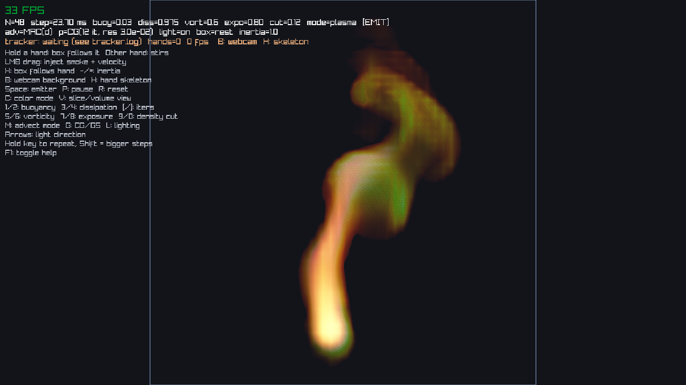

# 3D Fluid

A real-time 3D smoke and fire simulation in one C++17 file (`main.cpp`). It uses
[raylib](https://www.raylib.com/) for the window and input, and renders with a
GPU ray-marching shader.



## Features

- **Stable Fluids solver** on a 48³ grid, based on Jos Stam's method, with:
  - buoyancy driven by both density and heat, plus heat cooling and density dissipation
  - vorticity confinement to keep the small swirls
  - a choice of pressure solver: Jacobi-preconditioned conjugate gradient (default) or Gauss-Seidel relaxation
  - a choice of advection: semi-Lagrangian, or MacCormack with limiting on density only or on density and velocity
  - solid walls on every side except the top, which is open
- **Volume renderer**: a fragment shader ray-marches a 2D texture atlas built from the density and heat fields. It has
  single-scattering lighting with shadow rays, flame emission, and exponential tone mapping.
- **Four color modes**: smoke, fire, plasma, classic.
- **Slice view**: a 2D cross-section. It is also used automatically if the volume shader fails to compile.
- **OpenMP** parallelizes the solver loops when the compiler supports it.

## Building (Windows)

You need:

- [w64devkit](https://github.com/skeeto/w64devkit), which provides MinGW g++
- raylib built as a static library (`libraylib.a`)

`build.bat` expects the layout that the raylib Windows installer creates:

```
C:\raylib\w64devkit\bin\g++.exe
C:\raylib\raylib\src\        (raylib.h, raymath.h, rlgl.h, libraylib.a)
```

If your paths differ, change `GXX` and `RAYLIB` at the top of `build.bat`. Then run:

```bat
build.bat
```

The script first builds with `-fopenmp`. If that fails, it builds again without OpenMP. The output is a static
`fluid.exe`. Compiler errors and warnings go to `build.log`.

## Running

```bat
fluid.exe
```

A rotating emitter at the bottom of the box releases hot smoke continuously. You can drag in the view to add more
smoke and push the fluid.

### Controls

| Input              | Action                                                      |
|--------------------|-------------------------------------------------------------|
| LMB drag           | Add smoke and velocity                                      |
| RMB drag           | Orbit the camera                                            |
| Mouse wheel        | Zoom                                                        |
| Space              | Turn the emitter on or off                                  |
| P                  | Pause                                                       |
| R                  | Reset the simulation                                        |
| C                  | Switch color mode (smoke / fire / plasma / classic)         |
| V                  | Switch between volume view and slice view                   |
| 1 / 2              | Lower / raise buoyancy                                      |
| 3 / 4              | Lower / raise dissipation (how long smoke lasts)            |
| 5 / 6              | Lower / raise vorticity confinement                         |
| 7 / 8              | Lower / raise exposure                                      |
| [ / ]              | Lower / raise pressure-solver iterations (CG max iterations or GS iterations) |
| M                  | Switch advection mode: SL → MAC(d) → MAC(d+v)               |
| G                  | Switch the pressure solver between CG and Gauss-Seidel      |
| L                  | Turn lighting on or off                                     |
| Arrow keys         | Move the light direction                                    |
| F1                 | Show or hide the help overlay                               |

The status overlay shows FPS, time per step, the current parameters, the advection mode, and pressure-solver
statistics (CG iteration count and relative residual).

### Command-line options

These options are mostly for testing and benchmarking:

| Flag                 | Effect                                                                 |
|----------------------|------------------------------------------------------------------------|
| `--mode <0-3>`       | Starting color mode (0 smoke, 1 fire, 2 plasma, 3 classic)             |
| `--gs`               | Use Gauss-Seidel for pressure instead of CG                            |
| `--sl`               | Use plain semi-Lagrangian advection                                    |
| `--nolight`          | Start with lighting off                                                |
| `--screenshot`       | Run 180 frames, save `shot.png`, print solver metrics, then exit       |
| `--screenshot-slice` | Same as `--screenshot`, but in slice view, saving `shot_slice.png`     |
| `--lumcheck`         | Used with `--screenshot`: also print the mean luminance of the volume region |
| `--soak <frames>`    | Run the given number of frames without the frame cap, save `soak.png` (or `soak_slice.png`), then exit |
| `--sliceview`        | Start in slice view (useful with `--soak`)                             |
| `--testdrag`         | Simulate a circular mouse drag between frames 300 and 600              |

The screenshot runs print the average step time, average frame time, CG iterations, CG residual, and RMS divergence
before and after projection. These numbers make it easy to compare solver settings, for example:

```bat
fluid.exe --screenshot
fluid.exe --screenshot --gs --sl
```

## Project layout

```
main.cpp     solver (FluidCube), GLSL shaders, and app loop
build.bat    Windows build script (w64devkit + raylib)
*.png        screenshots from the test modes
```
